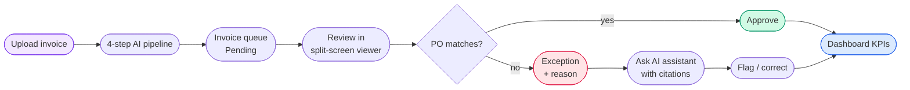
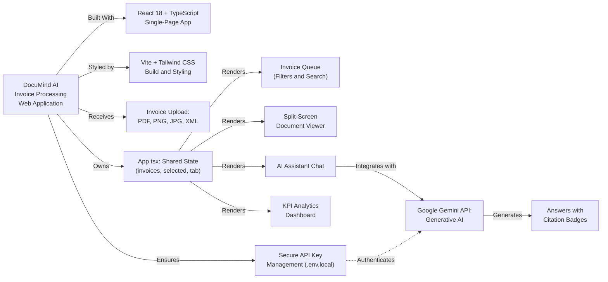
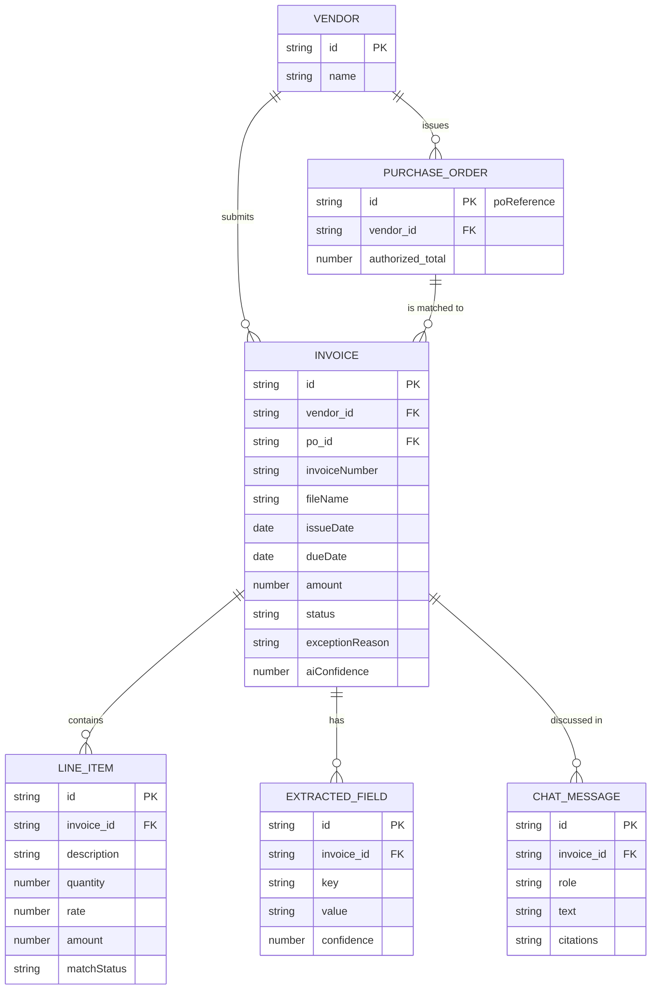

<div align="center">

<!-- 🖼️ HERO IMAGE: save your main screenshot as docs/screenshots/hero.png -->


<br/>

# 🧾 DocuMind AI

### Invoice Processing & Document Intelligence

**Review, verify, and approve vendor invoices in one place — with an AI assistant that shows its evidence.**

<br/>


<br/>

[**🚀 Quick Start**](#-quick-start) · [**✨ Features**](#-features) · [**📸 Screenshots**](#-screenshots) · [**🏗️ Architecture**](#️-architecture) · [**🗺️ Roadmap**](#️-roadmap)

</div>

---

## 📖 Table of Contents

| | | |
|---|---|---|
| 1. [About](#-about) | 7. [Data Model](#️-data-model) | 13. [Testing Checklist](#-testing-checklist) |
| 2. [Highlights](#-highlights) | 8. [Tech Stack](#️-tech-stack) | 14. [Build & Deployment](#-build--deployment) |
| 3. [Screenshots](#-screenshots) | 9. [Quick Start](#-quick-start) | 15. [Security Notes](#-security-notes) |
| 4. [Features](#-features) | 10. [Usage Guide](#-usage-guide) | 16. [Troubleshooting](#-troubleshooting) |
| 5. [How It Works](#-how-it-works) | 11. [AI Integration](#-ai-integration-google-gemini) | 17. [Real vs. Simulated](#-what-is-real-vs-simulated) |
| 6. [Architecture](#️-architecture) | 12. [Project Structure](#-project-structure) | 18. [Roadmap](#️-roadmap) · [Contributing](#-contributing) |

---

## 🔍 About

**DocuMind AI** is an intelligent invoice processing and document management web app for **finance and procurement teams**. It automates the review, verification, and approval of vendor invoices.

### The problem

| Pain point | What happens today |
|---|---|
| 📄 **Many formats** | Invoices arrive as PDF, scans, or XML and are keyed in by hand |
| 🐌 **Slow matching** | Three-way matching (invoice ↔ PO ↔ receipt) is done by eye and is error-prone |
| ⏰ **Late exceptions** | Totals above a cap, unauthorized add-ons, and price drift surface only at payment time |
| ❓ **No quick answers** | Reviewers can't ask a question and see where in the document the answer comes from |

### The solution

DocuMind AI puts everything in one interface: a **searchable invoice queue**, **AI-extracted data beside the original document**, **automatic PO-mismatch flags with reasons**, a **chat assistant that cites its sources**, and a **KPI dashboard** for managers.

> [!NOTE]
> **Release status — front-end prototype.** The UI, navigation, and state management are fully working. Invoice data, field extraction, PO matching, analytics, and the assistant's replies are **simulated** with sample data so the whole workflow can be demoed without a back end. See [Real vs. Simulated](#-what-is-real-vs-simulated).

---

## ⭐ Highlights

<table>
  <tr>
    <td align="center" width="25%">
      <h3>📋 Invoice Queue</h3>
      Filter, search, and triage every invoice by status
    </td>
    <td align="center" width="25%">
      <h3>🪟 Split-Screen Viewer</h3>
      AI-extracted fields beside the document, with bounding boxes
    </td>
    <td align="center" width="25%">
      <h3>🤖 AI Assistant</h3>
      Ask in plain English and get answers with citations
    </td>
    <td align="center" width="25%">
      <h3>📊 KPI Dashboard</h3>
      Volume, exceptions, time saved, and accuracy at a glance
    </td>
  </tr>
</table>

---

## 📸 Screenshots

> 💡 **How to add your images:** create the folder `docs/screenshots/`, drop your images in with the file names below, and they will appear automatically. Replace the file names if you prefer different ones.

### 📋 Invoice Table

Every vendor invoice in one queue — six filter tabs with live counts, search, colour-coded status badges, and the reason shown under each exception.

<div align="center">


</div>

<br/>

### 🪟 Document Review (Split-Screen Viewer)

Extracted fields with **AI Scores** on the left; the document canvas with interactive **bounding boxes** on the right. Approve, flag, or ask the AI from the title bar.

<div align="center">


</div>

<br/>

### ⬆️ Upload Vendor Invoice

Drag-and-drop **PDF, PNG, JPG, or XML** (up to 20 MB) — or try a one-click sample invoice.

<div align="center">


</div>

<br/>

### 🤖 AI Assistant & 📊 Dashboard

<table>
  <tr>
    <th align="center" width="50%">AI Assistant</th>
    <th align="center" width="50%">Dashboard Analytics</th>
  </tr>
  <tr>
    <td align="center">
     

      <!-- 🖼️ UPLOAD IMAGE HERE → docs/screenshots/ai-assistant.png -->
      
    </td>
    <td align="center">
      
       

      <!-- 🖼️ UPLOAD IMAGE HERE → docs/screenshots/dashboard.png -->
      
    </td>
  </tr>
  <tr>
    <td align="center"><i>Answers with citation badges</i></td>
    <td align="center"><i>KPIs, trend, precision, insights</i></td>
  </tr>
</table>

### 💻 Dev Server Running

<div align="center">


<!-- 🖼️ UPLOAD IMAGE HERE → docs/screenshots/dev-server.png -->


</div>

---

## ✨ Features

### 📋 Invoice Table

- **Six filter tabs** with live counts — *All · Pending Review · Exceptions · Matched · Approved · Paid*
- **Search** by vendor, invoice number, file name, or PO reference
- Columns for **vendor, invoice #, dates, PO reference, amount, status**
- **Colour-coded badges**, with exception reasons shown beneath the badge
- AI-suggested POs appear in italics with a `Suggested:` prefix
- Click any row to open it in the viewer

<div align="center">

<!-- 🖼️ OPTIONAL IMAGE → docs/screenshots/feature-filter-tabs.png -->


</div>

### 🪟 Split-Screen Document Viewer

| Panel | What it shows |
|---|---|
| **Extracted Fields** | Invoice #, vendor, dates, totals — each with an AI Score and an inline ✏️ editor |
| **Line Items** | Description, quantity, rate, amount, and match status |
| **PO Matching** | Comparison with the linked purchase order; every mismatch listed |
| **Document canvas** | Visual invoice with zoom and bounding boxes that highlight on hover |

<div align="center">

<!-- 🖼️ OPTIONAL IMAGE → docs/screenshots/feature-viewer-header.png -->


</div>

### 🤖 AI Assistant Chat

- Ask questions like *"Are there any PO discrepancies?"* or *"List all line items"*
- **Citation badges** under each answer — click one to highlight the supporting region on the document
- Example prompt pills and an invoice selector

<div align="center">

<!-- 🖼️ OPTIONAL IMAGE → docs/screenshots/feature-chat.png -->


</div>

### 📊 KPI Analytics Dashboard

KPI cards (documents analyzed, exceptions flagged, review time saved, AI accuracy) · weekly ingestion trend · field-level precision bars · AI Insights with recommended actions.

### ⬆️ Upload Modal

Drag-and-drop zone · simulated four-step AI pipeline · three one-click sample invoices.

### 🔄 Invoice Lifecycle

| Status | Colour | Meaning |
|---|---|---|
| **Pending** | 🟠 Amber | Newly ingested; awaiting human review |
| **Matched** | 🟣 Violet | Vendor, amounts, and PO agree — ready to approve |
| **Exception** | 🔴 Rose | A discrepancy was detected; reason shown |
| **Approved** | 🟢 Emerald | Approved for payment |
| **Paid** | ⚪ Grey | Payment completed; closed |

---

## 🔁 How It Works



**The four pipeline steps:** validate the file → extract tokens & bounding boxes → classify fields → check the 3-way match against open POs.

---

## 🏗️ Architecture

A **component-based single-page app with a single source of truth.** `App.tsx` owns the state and passes data and handlers down to the views. Views never change each other directly — they ask the root to update state, so badges, counts, and the header exception badge always stay in sync.



<div align="center">

<!-- 🖼️ OPTIONAL IMAGE → docs/screenshots/architecture.png -->


</div>

| Layer | Responsibility |
|---|---|
| **Presentation** | React 18 components styled with Tailwind CSS and Lucide icons |
| **State** | `App.tsx` holds `invoices`, `selectedInvoice`, `activeTab` and the handlers |
| **Intelligence** | Thin Gemini SDK wrapper that builds invoice-aware prompts |
| **Tooling** | TypeScript for typed data; Vite for the dev server and production bundle |

### Components

| Component | Responsibility |
|---|---|
| `App.tsx` | State owner and the four handlers |
| `Header.tsx` | Sticky nav, **Active** indicator, four tabs, exception badge, Upload button |
| `InvoiceTableView.tsx` | Filter tabs, live counts, search, table |
| `UploadModal.tsx` | Drop zone, simulated pipeline, sample shortcuts |
| `DocumentSplitViewer` | Fields / Line Items / PO Matching + canvas |
| `AiAssistantView` | Chat UI, prompt pills, citation badges |
| Dashboard view | KPI cards, trend chart, precision bars, insights |

### Data flow

```text
App.tsx (state owner)
├── invoices[] ─────────────────► InvoiceTableView    (display, filter, search)
├── selectedInvoice ────────────► DocumentSplitViewer (view, edit, approve, flag)
│                               ► AiAssistantView     (chat about the invoice)
├── handleUpdateField() ───────► edits an extracted field
├── handleApproveInvoice() ─────► status → 'Approved'
├── handleFlagInvoice() ────────► status → 'Exception' + reason
└── handleUploadDocument() ─────► adds an invoice and opens the viewer
```

---

## 🗄️ Data Model

In the prototype, vendor and PO are **fields of the invoice**. The diagram shows how they would map to tables once a back end exists.



### Core TypeScript types (simplified)

```ts
export type InvoiceStatus = 'Pending' | 'Matched' | 'Approved' | 'Exception' | 'Paid';

export interface ExtractedField { value: string; confidence: number; }   // 0–100 "AI Score"

export interface LineItem {
  description: string; quantity: number; rate: number; amount: number;
  matchStatus: 'matched' | 'mismatch' | 'unmatched';
}

export interface DocumentItem {
  id: string; vendor: string; invoiceNumber: string; fileName: string;
  issueDate: string; dueDate: string;
  poReference?: string; poSuggested?: boolean;
  amount: number; status: InvoiceStatus; exceptionReason?: string;
  aiConfidence: number;
  extractedFields: Record<string, ExtractedField>;
  lineItems: LineItem[];
}
```

---

## 🛠️ Tech Stack

| Technology | Role |
|---|---|
|  | UI library — one component per view |
|  | Typed invoice model shared by all views |
|  | Dev server (port 3000) and build tool |
|  | Utility-first styling (with PostCSS) |
|  | Icon set |
|  | AI model via `@google/genai` |

---

## 🚀 Quick Start

### Prerequisites

| Requirement | Notes |
|---|---|
| **Node.js 18+** | LTS recommended — [download](https://nodejs.org) |
| **npm** | Comes with Node.js |
| **Gemini API key** | Free from [Google AI Studio](https://aistudio.google.com) |

### ⏱️ 60-second setup

```bash
node --version && npm --version     # verify your tools
```

```bash
# 1. Get the code
git clone <your-repository-url> documind-ai-pro
cd documind-ai-pro

# 2. Install dependencies
npm install

# 3. Add your API key
echo "GEMINI_API_KEY=your_gemini_api_key_here" > .env.local

# 4. Run
npm run dev
```

Then open **<http://localhost:3000>** 🎉

<div align="center">

<!-- 🖼️ UPLOAD IMAGE HERE → docs/screenshots/dev-server.png (same as above) -->


</div>

### 🔑 Get a Gemini API key (step by step)

1. Open **[Google AI Studio](https://aistudio.google.com)** and sign in with your Google account.
2. Click **Get API key** (or go to the [API Keys page](https://aistudio.google.com/app/apikey)).
3. Click **Create API key**, choose a Google Cloud project, and confirm.
4. **Copy the key** right away and keep it private.

<details>
<summary><b>🧱 Setting the project up from scratch?</b></summary>

<br/>

```bash
npm install react@18 react-dom@18 lucide-react @google/genai
npm install -D vite @vitejs/plugin-react typescript tailwindcss postcss autoprefixer
```

**`index.css`**

```css
@tailwind base;
@tailwind components;
@tailwind utilities;
```

**`tailwind.config.js`**

```js
export default {
  content: ['./index.html', './src/**/*.{ts,tsx}'],
  theme: { extend: {} },
  plugins: [],
};
```

**`vite.config.ts`**

```ts
import { defineConfig, loadEnv } from 'vite';
import react from '@vitejs/plugin-react';

export default defineConfig(({ mode }) => {
  const env = loadEnv(mode, process.cwd(), '');
  return {
    plugins: [react()],
    server: { port: 3000, host: '0.0.0.0' },
    define: { 'process.env.GEMINI_API_KEY': JSON.stringify(env.GEMINI_API_KEY) },
  };
});
```

**`.gitignore`**

```gitignore
node_modules
dist
.env.local
*.local
```

</details>

### Environment variables

| Variable | Required | Description |
|---|---|---|
| `GEMINI_API_KEY` | For live AI | Read by `vite.config.ts` via `loadEnv` and exposed as `process.env.GEMINI_API_KEY` |

### Scripts

| Command | Description |
|---|---|
| `npm run dev` | Dev server with hot reload at <http://localhost:3000> |
| `npm run build` | Optimized production bundle in `dist/` |
| `npm run preview` | Serve `dist/` at <http://localhost:4173> |

---

## 📘 Usage Guide

<details open>
<summary><b>🔎 Review an invoice</b></summary>

1. Open **Invoices** and use the filter tabs or search to find an invoice.
2. Click a row — **Document Review** opens.
3. Check the **Extracted Fields**; hover a field to see its bounding box.
4. Fix any value with the ✏️ icon.
5. Check **Line Items** and **PO Matching**.
6. Click **Approve Invoice**, or flag it with a reason.

</details>

<details>
<summary><b>🚨 Resolve an exception</b></summary>

1. Select the **Exceptions** tab and open **Redwood Catering** (total is $93.80 above the authorized cap).
2. Click **Ask AI Assistant** and try *"Are there any PO discrepancies?"*
3. Click a **citation badge** to jump to the supporting region of the document.

</details>

<details>
<summary><b>⬆️ Add a new invoice</b></summary>

1. Click **Upload Invoice**.
2. Drop a file (PDF, PNG, JPG, XML ≤ 20 MB) or click a sample such as **Summit Pkg**.
3. Watch the four pipeline steps — the invoice opens in the viewer and lands at the top of the queue.

</details>

<details>
<summary><b>📊 Check performance</b></summary>

Open **Dashboard Analytics** for KPIs, weekly volume, precision bars, and AI Insights.

</details>

---

## 🤖 AI Integration (Google Gemini)

The assistant builds an invoice-aware prompt, asks Gemini for structured JSON, and renders the answer with citation badges.

```ts
import { GoogleGenAI } from '@google/genai';

const ai = new GoogleGenAI({ apiKey: process.env.GEMINI_API_KEY });

function buildInvoicePrompt(question: string, inv: DocumentItem) {
  return [
    'You are an accounts-payable assistant.',
    'Answer ONLY from the invoice data below.',
    'Return JSON: {"answer": string, "citations": string[]}',
    'INVOICE DATA:', JSON.stringify(inv),
    'QUESTION: ' + question,
  ].join('\n');
}

export async function askGemini(question: string, inv: DocumentItem) {
  try {
    const response = await ai.models.generateContent({
      model: 'gemini-2.5-flash',
      contents: buildInvoicePrompt(question, inv),
      config: { responseMimeType: 'application/json' },
    });
    return JSON.parse(response.text ?? '{}');
  } catch {
    return { answer: 'The assistant is unavailable right now.', citations: [] };
  }
}
```

**Citations:** each string (e.g. `invoiceNumber`, `totalAmount`, `poReference`) maps to a bounding box; clicking the badge highlights that region.

> [!TIP]
> **Going live:** the prototype uses keyword matching for replies. Swap it for `askGemini` — the UI needs no changes.

> [!NOTE]
> The code in this README is simplified and representative — check it against your source.

---

## 📁 Project Structure

```text
documind-ai-pro/
├── index.html
├── index.css
├── metadata.json
├── package.json
├── vite.config.ts
├── tailwind.config.js
├── postcss.config.js
├── tsconfig.json
├── .env.local            # 🔐 secret!
├── .gitignore
├── README.md
├── docs/screenshots/
└── src/
```

<div align="center">

<!-- 🖼️ OPTIONAL IMAGE → docs/screenshots/project-structure.png -->


</div>

---

## 🧪 Sample Data

**Ten pre-loaded invoices covering every status**

| Vendor | Status | Amount | Note |
|---|---|---:|---|
| Summit Packaging Co | Pending | $373.80 | Suggested PO-4419 |
| Redwood Catering | **Exception** | $793.80 | Over authorized cap by $93.80 |
| BluePeak Logistics | Approved | $1,016.00 | PO-7710 |
| Harbor Tech Systems | Paid | $1,317.60 | PO-5500 |
| Metro Clean Services | **Exception** | $1,074.60 | Invoice vs PO $950.00 |
| Northshore Fresh Foods | Matched | $1,917.00 | |
| Granite Facilities Mgmt | Matched | $1,803.60 | |
| Apex Office Supply | Pending | $628.56 | |
| Apex Logistics | Matched | $1,422.00 | |
| Acme Office Supplies | **Exception** | $1,305.00 | Price drift |

---

## ✅ Testing Checklist

| # | Test | Expected result |
|:-:|---|---|
| 1 | Open the app | Ten invoices; **All 10 · Pending 2 · Exceptions 3 · Matched 3 · Approved 1 · Paid 1** |
| 2 | Search `Redwood` | Only Redwood Catering remains |
| 3 | Click **Exceptions** | Three rows, each with a red reason |
| 4 | Click a row | Document Review opens |
| 5 | Edit **Total Amount**, save | New value persists |
| 6 | **Approve Invoice** | Status → Approved; counts update |
| 7 | Flag with a reason | Status → Exception; header badge rises |
| 8 | Ask *"List all line items"* | Answer with citations that highlight the canvas |
| 9 | Upload a sample invoice | Four steps animate; invoice opens in the viewer |
| 10 | Open **Dashboard Analytics** | KPIs, trend, precision bars, insights |
| 11 | Resize to phone width | Header tabs collapse into a scrollable sub-nav |

---

## 🌐 Build & Deployment

```bash
npm run build      # optimized files → dist/
npm run preview    # check the build at http://localhost:4173
```

Works on **Netlify · Vercel · GitHub Pages · Cloudflare Pages · Firebase Hosting**.

| Setting | Value |
|---|---|
| Build command | `npm run build` |
| Output directory | `dist` |
| Environment variable | `GEMINI_API_KEY` — set it in the host's dashboard, **never in the repo** |

> If the host returns **404 on refresh**, enable its single-page-app fallback to `index.html`.

---

## 🔒 Security Notes

> [!WARNING]
> **API key exposure** — Vite embeds `define` values in the browser bundle, so anyone can read the key in dev tools. Fine for a local prototype; for production, call Gemini from a **server or serverless function** that holds the key.

- **Never commit secrets** — keep `.env.local` in `.gitignore`; rotate the key if it leaks.
- **Sensitive documents** — invoices contain pricing and banking data; check data-handling terms before using a real model.
- **Uploads** — validate type and size on the server too; scan for malware.
- **Prompt injection** — invoice text may contain instructions aimed at the model; treat it as data and keep a human in the loop.
- **Access control** — production needs authentication, approval limits, and an audit trail.

---

## 🩺 Troubleshooting

| Symptom | Fix |
|---|---|
| `npm run dev` fails ("command not found") | Run `npm install` in the project root |
| Port 3000 already in use | Stop the other process or change `server.port` in `vite.config.ts` |
| Blank page, console error about `process` | `GEMINI_API_KEY` undefined — check the `define` block, restart the dev server |
| `.env.local` changes ignored | Vite reads env files at start-up — restart `npm run dev` |
| Styles missing | Check Tailwind directives in `index.css` and `content` paths in `tailwind.config.js` |
| Gemini **400 / 403** | Invalid or restricted key, or API not enabled |
| Gemini **429** | Rate limit — retry with back-off |
| Counts don't update after approving | State is being mutated — use immutable updates |

---

## 🎭 What Is Real vs. Simulated

| Capability | Status |
|---|:-:|
| UI, navigation, state management | ✅ Real |
| Filtering, search, approve / flag / edit | ✅ Real |
| Invoice data (10 samples) | 🎭 Simulated |
| AI field extraction (scores, bounding boxes) | 🎭 Simulated |
| Upload processing (timed delays, no parsing) | 🎭 Simulated |
| Assistant answers (keyword matching; Gemini configured, not yet called) | 🎭 Simulated |
| 3-way PO matching | 🎭 Simulated |
| Dashboard analytics | 🎭 Simulated |

---

## 🗺️ Roadmap

- [x] Invoice queue, split-screen viewer, assistant UI, dashboard, upload flow
- [ ] **Live AI** — replace keyword matching with `askGemini`; loading and error states; streaming
- [ ] **Real extraction** — Gemini multimodal / OCR → real fields and bounding boxes
- [ ] **Back end** — API, database, file storage, server-side Gemini proxy
- [ ] **Integrations** — ERP/accounting for POs, receipts, and payment status
- [ ] **Governance** — authentication, roles, approval thresholds, audit log, CSV/PDF export, pagination
- [ ] **Quality** — unit, component, and end-to-end tests; accessibility audit

---

## 🤝 Contributing

1. Fork the repo and create a branch: `git checkout -b feature/amazing-feature`
2. Commit: `git commit -m "feat: add amazing feature"`
3. Push: `git push origin feature/amazing-feature`
4. Open a Pull Request describing **what** and **why**

Please keep types accurate, use immutable state updates, and **never commit API keys**.

---

## 📄 License

Distributed under the **MIT License** *(replace if you use another)*.

---

<div align="center">

Built with ❤️ using **React**, **TypeScript**, **Vite**, **Tailwind CSS**, and **Google Gemini AI**

⭐ **Found it useful? Give the project a star!** ⭐

</div>
